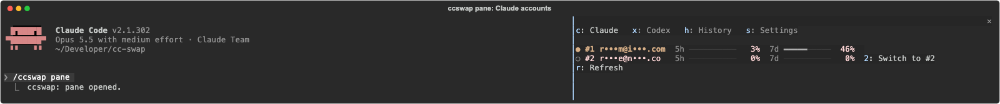

# Claude Code statusline and mod

Both are off until you turn them on, and each can be turned off again at any time.

```bash
ccswap config set claude.statusline on   # off puts back the statusline you had before
ccswap config set claude.mod on          # off uninstalls the plugin
```

The same two switches are in the TUI's **Settings…** menu ("Claude statusline", "Claude Code mod") and in the menu bar's Settings menu. `ccswap config` shows their real state, read from Claude Code, so removing either by hand shows it as off.

**Statusline.** Sets Claude Code's `statusLine` to `ccswap statusline`:

```
Opus 5.5 │ ✍️ 12% │ my-repo (main*) │ ⏱ 14m │ ◑ medium
#2 you@work.com │ next: #1 1%
5h ━━━───────  28% ⟳ 2:49pm
7d ━━━━━━━───  70% ⟳ oct 11, 1:59pm
```

Line 1 is the model, context used, folder and git branch, session time and effort. Line 2 is the active ccswap account and the account with the most headroom. The bars use the usage Claude Code reports, falling back to ccswap's cache; the statusline itself never calls the network. Your previous `statusLine` is saved in ccswap's settings (per Claude config folder) and restored when you turn it off. ccswap refuses to touch a `settings.json` that isn't valid JSON.

**Mod.** Installs the `ccswap` plugin from this repo's marketplace (`claude plugin marketplace add errhythm/ccswap`, then `claude plugin install ccswap@ccswap`). Needs Claude Code 2.1.287 or later with `claude` on your PATH. It adds:

- `/ccswap`: lists accounts. `/ccswap best`, `/ccswap next` and `/ccswap 2` (or an email) switch. These answer at once, even while Claude is working.
- `/ccswap pane`: a pane with four tabs. Press `c` Claude (usage bars, the slot's digit switches to it), `x` Codex, `h` History (recent switches), `s` Settings (threshold, strategy, binding windows, statusline). `r` refreshes, Esc closes.
- A band above the prompt when the active account passes your auto-switch threshold, with a button to switch to the best account. Typing that digit into an empty prompt presses it.
- A toast when the active account changes, for example after `ccswap auto` switches.



After turning the mod on or off, run `/reload-plugins` in any open Claude Code session. To install it by hand instead, run this at the Claude Code prompt:

```
/plugin install ccswap --marketplace errhythm/ccswap
```
